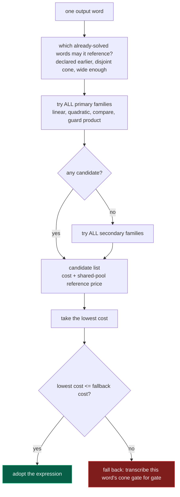
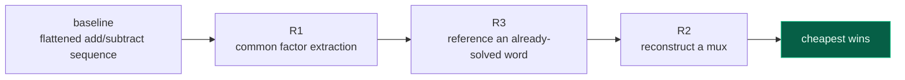
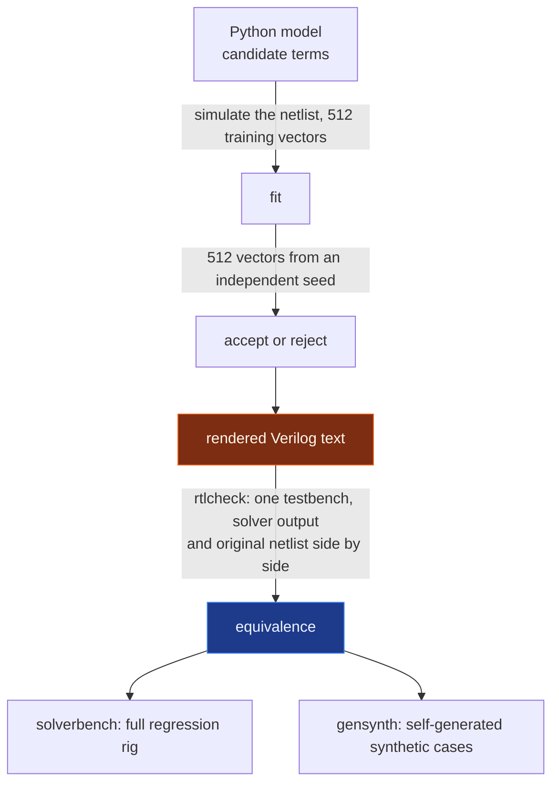
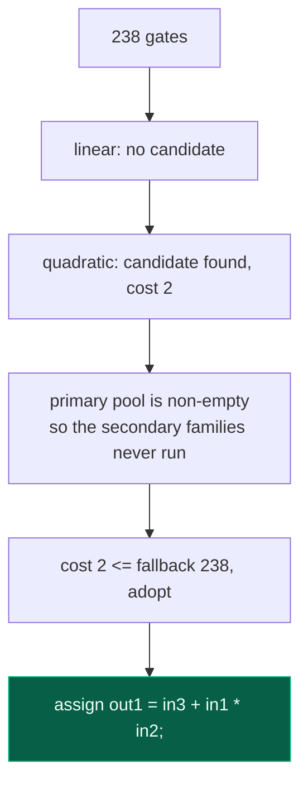

# arith-rtl-recovery

Recovers a functionally equivalent **RTL** expression with the fewest operators from a **gate-level netlist**.

In EDA this is called **datapath extraction** — recognizing a pile of scattered logic gates
for what they originally meant arithmetically.

## Problem

> **2022 ICCAD CAD Contest — Problem A: Learning Arithmetic Operations from Gate-Level Circuit**
> Problem authors: Chung-Han Chou, Chih-Jen (Jacky) Hsu, Chi-An (Rocky) Wu, Kuan-Hua Tu
> / Cadence Design Systems, Inc.

Given a flattened Verilog netlist that contains only primitive gates (`and or nand nor not buf xor xnor`),
recover an equivalent RTL:

```
reduction_rate = (1 − cost / gate_count) × 100%      per case must be ≥ 70%, otherwise that case scores 0
```

`cost` is the total operator cost (`+ - * / ** % > >= < <= == != ! && || << >> ?:` each cost 1,
bitwise ops `~ & | ^` cost per bit, `wire`/`assign`/`signed` are free), so **the score is just the cost itself**.

```bash
python3 solver/main.py -input <netlist.v> -output <rtl.v>
```

Single-threaded, uses only the Python standard library, calls no external tools.

---

## ⚠ This is an open core, not the full version

What this repo makes public is the **framework, the verification toolchain, and four expression families** (linear, quadratic, comparison,
and guard-product). A further batch of families handling harder shapes, plus the common-subexpression optimization layer, **are not in this repo**.

**There is an unreleased version that performs markedly better than this repo on the same test set.**

Measured figures for the version in this repo:

| | this repo (4 families) |
|---|---|
| total cost over all 30 cases | **60,360** |
| overall reduction | 70.90% |
| fully recovered / partial / all fallback | **19 / 3 / 8** |

⚠ **That 70.90% is a weighted number; it does not mean "passing".** It is inflated by a single case with 91,584 gates;
the problem's 70% threshold is judged **per case**, so this version of the repo actually has **11 cases
scoring 0** (8 full fallbacks + 3 partial solves). We are stating the number plainly rather than reporting a flattering average.

**But equivalence is never compromised**: when a shape is not recognized, the fallback path kicks in — **the entire netlist is transcribed as-is into Verilog**.
The cost looks bad, but the output is **guaranteed equivalent**. This discipline is non-negotiable: we would rather a whole case score low
than emit non-equivalent RTL. All 30 cases pass `rtlcheck`.

Of the 19 fully-solved cases, **15 have a cost that exactly matches the hand-reverse-engineered solution**.

---

## Algorithm and program flow

### Top-level pipeline

The input is a flattened Verilog netlist containing nothing but primitive gates. The output is
RTL that is functionally equivalent and uses as few operators as possible. **The solver never reads wire names** -- in the real problem
they are stripped, so there would be nothing to read.

```mermaid
flowchart TD
  A["netlist.v"] --> B["Netlist()<br/>parse, build driver map"]
  B --> C["generate validation vectors<br/>two independent seeds, 512 each"]
  C --> D["decide()<br/>one output word at a time"]
  D --> E["final rewrite passes"]
  E --> F["assemble()<br/>emit text, then assert seven invariants"]
  F --> G["rtl.v"]
  B -. "any exception anywhere" .-> X["emergency fallback<br/>transcribe the whole netlist gate for gate"]
  D -. .-> X
  E -. .-> X
  F -. .-> X
  X --> G
```

The fallback has three descending levels: transcribe the whole netlist gate for gate, copy the input file verbatim, then emit an empty module.
**The program never crashes and never emits RTL that is not equivalent** -- at worst it emits something expensive.

### The per-word decision

`decide()` walks the output words in declaration order. A word is either recovered as one whole `assign`,
or it falls back as a whole -- **there is no partial recovery inside a word**.



Two properties are easy to get wrong when reading the code:

- **Families are not first-come-first-served.** Every primary family runs, and the cheapest candidate wins.
- **Secondary families run only when the primary pool came up empty.** This is a deliberate safety constraint, not an optimisation:
  it guarantees that adding a family can never change the output of a word that **already had an answer**.

All four families published in this repo are primary:

| kind | what shape it recognises | example |
|---|---|---|
| `linear` | weighted sums of ports | `3*in1 + 5*in2 + 7` |
| `quadratic` | degree-2 polynomials, products included | `in1*in2 + in3` |
| `compare` | comparisons `sum(c*atom) REL k` | `(in1 - in3) > in2` |
| `mux` | guard products | `in4 ? (in1*in2) : 0` |

### Expression rendering and its rewrites

The two families whose result is a term list (`linear`, `quadratic`) do not simply flatten the terms. The renderer
builds four candidate renderings and keeps the cheapest, and **a rewrite replaces the incumbent only on a strict improvement** -- ties keep the earlier
one, which is what makes the output byte-stable across releases.



### Verification layers

The solver fits against simulation, but **fitting well is not the same as being correct**. The gap between the Python model and the emitted
Verilog **text** is where this project has produced the most real defects.



`rtlcheck` is the only instrument that **crosses from the model into the text** -- it actually runs the output in a simulator.

### A worked example

The `demo/` netlists are generated on the spot by `demo/gen_netlists.py`, so **no contest material is needed**:

```bash
python3 demo/gen_netlists.py
python3 solver/main.py -input demo/netlists/d4_macc.v -output /tmp/out.v --verbose
#   out1: solved by quadratic, cost 2 vs fallback 238
```



238 gates recovered as two operators, a reduction of 99.2%, `rtlcheck` PASS.

---

## Contest results (Alpha / Beta)

The organizers published result sheets for the Alpha Test and the Beta Test. Scoring
**the version in this repo** (four families only) under the original rules gives:

```
reduction_rate = (1 - cost / gate_count) x 100%   must be >= 70%, else 0 points for that case
point          = min(cost of the case from all teams) / cost
final_score    = sum of point over all cases
```

| | this repo (4 families) |
|---|---|
| **Alpha Test** | **14.00 / 20, 1st of 7 teams** |
| **Beta Test** | **14.00 / 20, 1st** |
| Beta: upper bound for any single team | 13.32 / 20 |

⚠ **Two things need saying, or that table reads better than it is.**

**First, this repo wins by a hair.** In the Beta column, 14.00 against an upper bound of 13.32 -- a margin of 0.68.
On a different set of unseen shapes that margin could flip at any time.

**Second, Alpha wiped almost everyone out.** Across six teams and twenty cases, only `test01`
and `test02` scored at all; every other case was either a `Fail` or a submission whose reduction rate fell far below 70%. Scoring 14
in a field where everyone else scored 1 or 2 says the problem was hard that year, not that this version is strong.

In the Beta sheet the row counts vary and every case is sorted by ascending cost, so a row is **a rank within that case**, not a fixed
team slot; individual team totals are therefore not recoverable. The upper bound above is a hypothetical team assembled from the best
entry of every case, so **no real team can be above it**. In the Alpha sheet every case has exactly
six rows and a `Pass` can appear below a `Fail`, which means rows are fixed team slots -- so full standings can be reconstructed.

### Final: no official result exists

The organizers published only the Alpha and Beta sheets. There is **no final scoreboard**, so there is no opponent
to compare against and **no rank can be given**. What can be reported is this repo's own result over all 30 cases:

| | |
|---|---|
| fully recovered / partial / all fallback | **19 / 3 / 8** |
| cases clearing the 70% bar | **19 / 30** (judged per case) |
| total cost / total gates | 60,360 / 207,397 |
| overall reduction | 70.90% (a weighted figure -- see the caveat in the previous section) |

### Three caveats

1. **Alpha and Beta covered only the 20 public cases.** The organizers' Q&A confirms the final evaluation
   contained withheld cases, but the proportion was never settled -- the wording is only 'may have 50%'. Performance on unseen
   shapes is not measured by any number above.
2. **The timelines are not comparable.** This is today's solver against test sets from 2022, built with those cases
   in hand and iterated on repeatedly, while the entrants worked to a deadline.
3. **Costs are computed by this repo's `tools/costcount.py`**; the official grader may differ in detail.

The official result sheets themselves are **not redistributed with this repo** (copyright belongs to the organizers); obtain them from
the [ICCAD CAD Contest](http://iccad-contest.org/) website.

---

## Why this problem matters

This problem was not invented just for the contest. The problem statement opens with its motivation:

> The ability of extracting circuit functionality from a gate-level netlist is
> critical in CAD tools since it can help **identify malicious circuits**,
> **speed up Engineering Change Order (ECO) process**, and **benefit formal
> verification**.

Breaking that down:

- **Formal verification**: comparing an RTL multiplier against its synthesized gate-level netlist for equivalence blows up
  bit-by-bit SAT/BDD reasoning exponentially. Recognizing that "this pile of gates is actually a multiplier" lets you switch to word-level
  reasoning, the standard approach commercial equivalence checkers use for arithmetic circuits. This repo's `tools/zcheck.py`
  demonstrates exactly what wall you hit if you skip that step.
- **ECO**: to patch a chip that has already been synthesized and routed, you first need to know what the existing netlist computes before you know
  where the smallest fix is.
- **Hardware security**: given third-party IP of unknown provenance, or a reverse-engineered netlist, identifying what it actually does
  — finding trojans, finding IP theft. This is also what the academic "netlist reverse engineering" line of work does.

⚠ But to be clear: **the contest's scoring metric (fewest operators) is a proxy, not an industry metric.**
What industry wants is "can it be recognized, and can equivalence be proven" — not "how short is the expression". This repo therefore
treats equivalence as a non-negotiable floor (transcribe the whole thing if it can't be recognized); cost is only a secondary goal.

---

## See what it does in five minutes

```bash
./demo/run_demo.sh
```

Requires `python3` and `iverilog` (macOS: `brew install icarus-verilog`). Takes about 10 seconds,
**needs no contest-organizer test data** — `demo/gen_netlists.py` uses `tools/refgen.py` to compile arithmetic specs
into gate-level netlists on the fly.

For each of the five netlists it runs four steps: solver recovers RTL → print it → compute cost → run iverilog to verify equivalence.

| netlist | actual expression | recovered | cost |
|---|---|---|---|
| `d1_add3` | `in1 + in2 + in3` | `in1 + in2 + in3` | 2 |
| `d2_linear_const` | `3*in1 + 5*in2 + 7` | `12'd3*in1 + 12'd5*in2 + 12'd7` | 4 |
| `d3_cmp_mux` | `(in1 < in2) ? in3 : in4` | **fallback: gate-level transcription as-is** | 73 |
| `d4_macc` | `in1 * in2 + in3` | `in3 + (in1 * in2)` | 2 |
| `d5_shift_sub` | `(in1 << 3) - in2` | `11'd8*in1 - in2` | 2 |

`d3_cmp_mux` is deliberately left failing — it demonstrates the fallback path: **the cost looks bad, but equivalence verification still PASSes**.

---

## What this repo is really about: verification methodology

The pitfall we hit over and over is not "the model computed wrong", but **"the Python model is correct, but the rendered Verilog
text is not"** — width propagation, signedness, the left operand of `<<` gets its width from context,
`**` is not truncated first in a wide context. These defects live in the gap between the model and the text — **only feeding the text into
a real simulator can cross that gap**.

So the toolchain divides the work like this:

| tool | what it does | why it's needed |
|---|---|---|
| `tools/rtlcheck.py` | Renames the recovered RTL and the original netlist and drops them into **the same testbench**, running vector by vector | the only gate that actually **executes** the output Verilog text |
| `tools/refgen.py` | Compiles arithmetic specs into primitive-gate netlists | produces a "known-answer" gold standard, no need to depend on contest-organizer test data |
| `tools/gensynth.py` | Generates the synthetic cases in `testcase_synth/`, and self-checks that "netlist == golden spec" | fills in paths the real test data never exercises (signed, negative coefficients, constant outputs, unused ports) |
| `tools/solverbench.py` | Full-case regression rig: runs the solver, verifies equivalence, computes cost | `rtlcheck FAIL` is the most severe failure, always check it first |
| `tools/costcount.py` | Counts operator cost from the Verilog text | hand-computed cost comments drift out of sync with the actual expression; this replaces hand-counting with machine-counting |
| `tools/zcheck.py` | Uses z3 to formally verify equivalence between netlist and spec | hits an exponential wall when multiplication is involved, which is exactly why the simulation route above exists |
| `tools/classify.py` | Infers operator candidates from the netlist | **boundary sampling is essential**: purely random wide-word vectors cannot distinguish `<` from `< k` |

Two criteria are baked into the tools:

- **Boundary vectors are not optional.** `in1 < in3` and `in1 < in3 - 9` differ with probability only 9 in 2^32,
  which 4,000 random vectors will never hit, letting a wrong hypothesis pass every time. `rtlcheck` therefore routes a quarter of
  the vectors through a small-value domain (cycling the mask among 3/15/63/255).
- **"Zero counterexamples" must be paired with "N times actually exercised".** Adversarial fuzzing of the search once ran 16,000 cases,
  with 0 false acceptances — but only 31 of them actually took the accept path, the other 15,969 tested nothing at all. So the evidence
  scripts always assert **both** "false acceptances = 0" and "accepted count ≥ lower bound".

---

## Architecture

```
solver/
  main.py       CLI, decision loop, fallback, invariant checks
  netlist.py    netlist parsing and simulation
  registry.py   family registry: scans solver/*.py, collects modules that declare FAMILY
  model.py      expression renderer (width, signedness, constant literals, algebraic rewrites)
  share.py      pool of common subexpressions shared across words
  fallback.py   fallback: transcribes the gates in a cone as-is
  linear.py     linear family
  quadratic.py  quadratic family (word-level)
  compare.py    comparison family
  mux.py        guard-product family
```

`decide()` runs per output word: **primary** families propose candidates first; only when all of them have none does it run
the **secondary** families (this "only try when candidates are empty" rule is a safety design, not a performance optimization —
a word that already has a candidate is never touched by a later family, so the output is provably non-regressing); finally the best candidate is compared against the fallback on cost, and the smaller one wins.

### Adding a family

Drop a new module in `solver/`, declaring at the end of the file:

```python
FAMILY = {
    "kind": "mine",              # globally unique
    "label": "my family solved",
    "order": 45,                 # globally unique, decides try order
    "stage": "primary",          # or "secondary"
    "shape": "expr3",            # "expr3" returns (expr, signed_needs, pool_refs)
                                 # "res"   returns (k_const, terms), handed to the shared renderer
    "build_context": lambda env: build_context(env.nl, env.val_vectors, env.val_results),
    "attempt": lambda env, ctx, name, width: try_mine(env.nl, name, width, ctx, env.pool),
}
```

`registry.discover()` picks it up automatically. **The format is enforced by validation that raises, not by convention** — a missing field,
`stage`/`shape` not being an enum member, or a duplicate `kind`/`order`, all raise `ValueError` on the spot and name
exactly which module and field is broken.

This validation has a measured reason: mistype a family's `"stage"` by one character and neither stage list selects it,
**the whole family is silently excluded from dispatch while all tests stay green** — data-driven dispatch would otherwise downgrade a typo from a
`NameError` to a silent missed dispatch, so the format must be able to yell on its own.

The `SOLVER_FAMILIES=linear,quadratic` environment variable can enable only the named families, useful for isolating tests.

---

## Requirements

- **Python 3** — `solver/` has zero external dependencies (this is a self-imposed constraint; the problem places no restriction on language or packages)
- **Icarus Verilog** — `brew install icarus-verilog`. Needed by `tools/rtlcheck.py`
- **z3** (optional) — `tools/zcheck.py` needs `pip install z3-solver`
- **ABC** (optional) — Homebrew has no formula; `abc.lock` pins the exact upstream commit,
  `scripts/setup_abc.sh` builds against it, `scripts/find_abc.sh` prints which one to use

---

## Getting the test data

This repo **does not include** the contest organizer's materials — the problem statement, Q&A, official test results, and the copyright
of the 30 testcases belong to the organizer; please obtain them yourself from the official [ICCAD CAD Contest](http://iccad-contest.org/) website,
and place them as `testcase/testNN/top_primitive.v` (NN = 01..30). This path is already listed in `.gitignore`.

**The project runs fully without that test data**: `demo/` and `testcase_synth/` (12 self-produced synthetic cases)
do not depend on it.

```bash
./demo/run_demo.sh                       # needs no test data
python3 tools/solverbench.py --synth     # 12 synthetic cases, needs no test data
python3 tools/solverbench.py             # all 30 cases, needs test data
python3 tools/selftest.py                # unit tests
```

---

## License

[Apache License 2.0](LICENSE).

The contest organizer's materials are not covered by this license and are not included in this repo.
